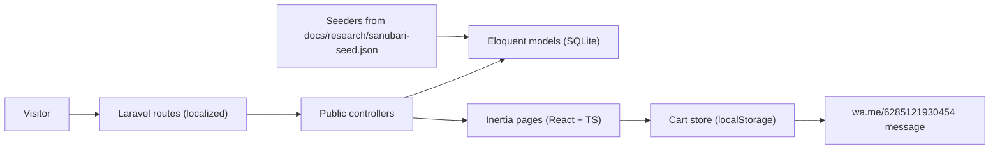

# Implementation Plan — Sanubari Public Website

> Read [`ORIGINAL_PROMPT.md`](ORIGINAL_PROMPT.md) and [`research/FINDINGS.md`](research/FINDINGS.md) first.
> Status: **Ready to implement.** Palette supplied (`docs/brand/color-palette.jpeg`, sampled below).

## 0a. Brand palette (sampled from `docs/brand/color-palette.jpeg`)

The logo is a white owl plus the "SANUBARI ROASTERY" wordmark on solid **`#2E474E`** (sampled at 4 points), with an "Alat Kopi Malang · Est. 2017" seal.
We use this colour wherever nircoffee uses its red.

| Token | Hex | Use |
| --- | --- | --- |
| `brand-900` | `#1B2B2F` | Footer, dark hero overlay |
| `brand-800` | `#24393F` | Hover on primary |
| **`brand-700`** | **`#2E474E`** | **Primary: buttons, header solid, accents** |
| `brand-500` | `#4F6E76` | Secondary text on light, borders active |
| `brand-300` | `#9DB3B8` | Muted icons, dividers on dark |
| `brand-100` | `#E3EBEC` | Tinted cards, pill hover |
| `cream-50` | `#F7F5F0` | Page background (warm off-white) |
| `sand-200` | `#E8E1D4` | Section bands (like nircoffee's beige CTA band) |
| `ink` | `#14191B` | Body text |
| `accent-copper` | `#B8794A` | Italic accent word in headings, sale/"new" badges (coffee warmth) |
| `white` | `#FFFFFF` | Logo, text on brand |

- Headings use a geometric sans (Montserrat/Raleway-like, matching the wordmark), bold, with a light **italic accent word** in `accent-copper`.
- Dark sections use `brand-900` with a full-bleed photo at about 60% overlay. Light sections use `cream-50`.
- Logo assets still needed as SVG/PNG. The owl will be traced from the image if no vector is provided.

## 0. Decisions (agreed 2026-10-22)

| # | Topic | Decision |
| --- | --- | --- |
| D1 | Pages | All: Home, Shop, Product, About, Wholesale, Visit Us, Brew Guide, Blog (list+detail), Events (list+detail), Legal |
| D2 | Buying | Cart in browser (localStorage) → checkout form → **WhatsApp order message**. No payments, no accounts |
| D3 | Language | **Indonesian (default) + English**, switcher in header, URL prefix `/en/...` for English |
| D4 | Starter-kit auth | Keep routes/pages, **hide from public navigation** |
| D5 | Visual | nircoffee-like layout (editorial heroes, numbered sections, rounded cards, pill filters) with **Sanubari palette — user will supply a palette image** |
| D6 | Images | Download Sanubari product images into `storage/app/public/seed/` via a seeder command |
| D7 | Admin | Out of scope. Data lives in DB tables + seeders so any admin (Filament, WP-like CMS, etc.) can be added later |

## 1. Architecture

- Server-rendered data via Inertia props (better SEO than nircoffee's empty-shell SPA).
- Enable Inertia **SSR** for crawlable HTML + per-page `<title>`/meta/OG.
- Translatable fields stored as JSON `{id, en}` (`spatie/laravel-translatable`); UI strings in `lang/{id,en}.json`.

## 2. Data model

| Table | Key columns |
| --- | --- |
| `categories` | name{id,en}, slug, parent_id, type (filter/espresso/brand), sort |
| `products` | name, slug, series (`classic`/`experimental`/`co-ferment`/`espresso`/`houseblend`/`robusta`), tagline{}, description{}, tasting_notes, origin, region, varietal, process, altitude, brew_methods, roast_level, is_featured, is_new, released_at, status |
| `product_variants` | product_id, label (15 g…1 kg), weight_grams, price, stock_status, sku |
| `product_images` | product_id, path, alt, sort, is_primary |
| `category_product` | pivot |
| `posts` | title{}, slug, excerpt{}, body{}, cover, published_at |
| `events` | title{}, slug, body{}, starts_at, ends_at, location, address, fee, capacity, register_url (WhatsApp) |
| `pages` | key (about/wholesale/visit/brew-guide/legal-*), title{}, sections JSON{} |
| `settings` | key/value: WhatsApp, maps URL, address, hours, socials |

Seed source: `docs/research/sanubari-seed.json` (56 products, 9 categories). A parser extracts
Origin/Varietas/Process/Altitude/Brew Method/Taste Profile from the Woo description text.
Blog posts, events, brew guides and legal text = dummy content written in Sanubari's voice.

## 3. Routes (public)

| Route (ID / EN) | Page | nircoffee equivalent |
| --- | --- | --- |
| `/` · `/en` | Home | `/` |
| `/shop` | Shop listing (filters: Filter/Espresso → sub-process, search, sort) | `/shop` |
| `/shop/{category}/{slug}` | Product detail | `/shop/{series}/{type}/{slug}` |
| `/tentang` · `/en/about` | About / Story | `/about` |
| `/wholesale` | Wholesale & B2B | `/wholesale` |
| `/kunjungi` · `/en/visit` | Visit us (Sanubari x Alat Kopi Malang) | footer "Visit us" |
| `/panduan-seduh` · `/en/brew-guide` | Brew guide | `/brewguide` |
| `/blog`, `/blog/{slug}` | Journal | `/blog` |
| `/acara`, `/acara/{slug}` · `/en/events/...` | Events | `/events` |
| `/keranjang` · `/en/cart` | Cart + WhatsApp checkout form | `/cart`, `/checkout` |
| `/legal/{privacy,terms,refund}` | Legal | `/legal/*` |
| `/sitemap.xml`, `/robots.txt` | SEO | same |

## 4. Phases

### Phase 1 — Foundation & data (no UI dependency)
1. Install `spatie/laravel-translatable`; locale middleware + route groups (`id` default, `/en` prefix).
2. Migrations + models + factories for §2.
3. `php artisan sanubari:import-seed` — reads `sanubari-seed.json`, parses specs, downloads images to `storage/app/public/seed/`, idempotent. `DatabaseSeeder` calls it + dummy posts/events/pages/settings.
4. Public controllers returning Inertia props; share `settings`, `locale`, nav categories globally.
5. Pest feature tests: every public route 200, product 404 on unknown slug, locale switching, sitemap lists all products.

### Phase 2 — Design system & responsive layouts (Unblocked)
1. Tailwind v4 `@theme` tokens from the palette (colors, Raleway-like type scale, radii, shadows).
2. Primitives:
   - Button (pill `rounded-full` or card `rounded-lg`).
   - Eyebrow (numbered label e.g. `01 / ON THE BENCH`).
   - SectionHeading (bold + italic copper accent word).
   - Desktop Product Card: Editorial minimalist card with clean typography, bag photo, tasting notes, and price.
   - Mobile Product Card (Otten shape): 1:1 square photo with rounded top, floating tag badge (top-left), wishlist icon (top-right), 2-line title, strikethrough + current price, ratings/sold count, and full-width `+ Keranjang` button.
   - Category Quick Action Circles (Otten shape): 56x56 circular icon badges with label underneath.
   - Pill filter chips (Otten shape): horizontally scrollable filter chips.
3. Layouts:
   - `PublicLayout`:
     - **Desktop (NiR style)**: Transparent-over-hero header → solid on scroll, mega-menu for Shop, language switcher, cart badge count, 4-column footer, floating WhatsApp button.
     - **Mobile (Otten shape)**: Sticky search bar with Sanubari logo + search pill, dismissible announcement ticker, and sticky 5-item bottom navigation bar (`Home`, `Kategori/Shop`, `Panduan Seduh`, `Keranjang`, `Kontak`).
4. Motion: reveal-on-scroll, hero parallax, smooth horizontal scroll gestures for carousels.

### Phase 3 — Pages
1. **Home:**
   - **Mobile Viewport (<768px)**: Otten Coffee functional commerce layout:
     - Sticky search bar + announcement ticker
     - Horizontal quick filter pills (`Semua`, `Filter Beans`, `Espresso Beans`, `Kawi Brand`, `New Arrival`)
     - Hero campaign carousel (`rounded-2xl`, dot pagination)
     - Circular category icon badges (Arabica, Robusta, Houseblend, Classic, Experimental, Co-Ferment, Merch)
     - Fresh Roast / Spotlight card with countdown/roast date
     - Horizontal product carousels ("Biji Kopi Terpopuler", "Koleksi Gunung Kawi", "Produk Terbaru")
     - Curated collection 2-col tiles ("Baru Mulai Ngopi?", "Paket Buka Cafe", "B2B Wholesale")
     - Brew guides & Roastery location card
     - Sticky bottom nav
   - **Desktop Viewport (>=768px)**: NiR Coffee clean editorial layout:
     - Hero full-bleed video/photo with bold typography & italic accent
     - "01 / Jejak Rasa di Gunung Kawi" editorial introduction
     - "02 / On the Bench" featured coffees
     - Collections showcase & process breakdown
     - Wholesale & B2B band
     - Sanubari x Alat Kopi Malang joint roastery & showroom
     - Comprehensive 4-column footer
2. **Shop:** Search, sort, series/process filter pills, grid of products, tasting notes badges, variant selector, instant cart drawer.
3. **Product Detail:** Multi-angle image gallery, variant pills (15g, 100g, 200g, 500g, 1kg), price, quantity stepper, add-to-cart, grind size selector, freshness slider, spec tiles (Origin, Farm, Process, Altitude, Varietal, Roast Level), transparency info, and related beans.
4. **About, Wholesale, Visit Us, Brew Guide:** Editorial rich pages with photo heroes and numbered sections.
5. **Blog & Events:** List and detail views with WhatsApp registration.
6. **Legal Pages:** Privacy, Terms, Refund policy.

### Phase 4 — Cart & WhatsApp checkout
1. Cart store (React context + localStorage), add/update/remove, persisted across reloads.
2. Cart page & drawer: line items, grind preferences, subtotal, customer checkout form (Name, WhatsApp number, Address, Notes).
3. Server endpoint `POST /cart/quote` re-prices lines from DB (prevents tampered prices) and returns the formatted message → open `wa.me/6285121930454?text=...`.

### Phase 5 — SEO, performance, polish
1. Inertia SSR, `<Head>` per page, OG images, JSON-LD (`Product`, `Organization`, `LocalBusiness`, `BreadcrumbList`), `hreflang`.
2. Image `srcset` (thumb/medium/large generated at import), lazy loading.
3. Accessibility pass, Lighthouse ≥ 90, responsive QA at 375/768/1440.

### Phase 6 — Verification
- `composer test`, `npm run types:check`, `npm run build`.
- Browser walkthrough of every route on http://sanubari.test (ID + EN), screenshots saved to `docs/qa/`.

## 5. Out of scope (explicit)
Admin/backend CMS · payments · customer accounts · shipping-rate APIs · order storage ·
nircoffee-specific tools (price calculator, BYOB, transparency cost breakdown, brew studio).

## 6. Sub-project
`tools/website-cloner` (ai-website-cloner-template, git-ignored, origin removed, `npm run check` ✅)
— available to clone sanubariroastery.id public pages for pixel/asset reference.

## 7. Open items
- [x] Colour palette supplied (`docs/brand/color-palette.jpeg` -> `#2E474E` slate-teal primary).
- [x] Logo file verified (`docs/brand/logo-circle.png` 512x512 ARGB transparent PNG).
- [x] Otten Coffee mobile layout captured and analyzed (`docs/research/screenshots/otten-mobile/`).
- [x] Real address / opening hours confirmed (Malang, 09.00–23.00, WhatsApp `6285121930454`).

